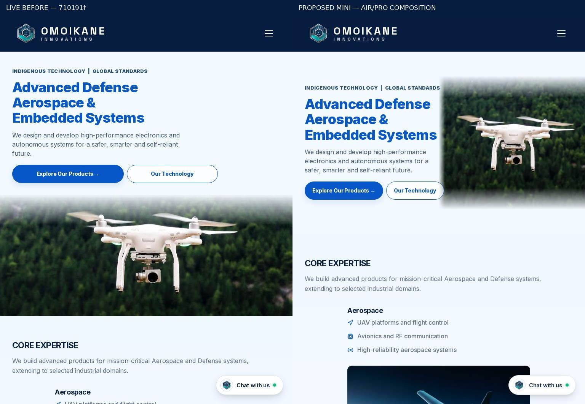

# Mini Home hero: Air/Pro composition

The owner's latest instruction supersedes the stacked Mini Home hero from PR #71: use the same left-copy/right-aircraft composition as Air and Pro, with enough room for both.

- Live/main baseline: `710191f2e36dfa42c47a3f1480a48568f0dde33c`, READY deployment `dpl_HhFo72hzx8GSwSzGvWq8wdVcmJt9`.
- Implementation: `88696d637a93803fdd4fa3d1def74ce43fc31459`, source tree `0f8b77e320d416924ad490b3fe5e127930b21f1d`.
- Branch: `fix/mini-home-inline-hero-20261127`. Review only; automatic deployment disabled. No merge or deployment performed.

| At Mini 768×1024 | Before | Proposed |
|---|---|---|
| Composition | Copy above photograph | Left copy, aircraft on right, matching Air/Pro |
| Hero height | 695.7px | 480px |
| Copy width | 540px | 366px |
| Headline / line height | 36px / 40.32px | Same approved size and three lines |
| Media | Full-width 768×320 frame | Right media area 384×352, landscape source |
| CTAs | Below wide copy | Both remain on one row, ≥48px high |

The full aircraft is visible at 768px and stays clear of the headline, description and buttons. The existing photograph is retained. A short horizontal fade and top/bottom fade blend the forest into the existing hero background. Across 681–768px, the media frame scales and shifts right while the 366px copy measure remains readable; the 681, 720 and 740px captures are included.

## Scope and checks

- `frontend/src/components/shared/HeroBanner.jsx`: Mini uses the existing desktop source; the phone source continues through 680px.
- `frontend/src/components/shared/HeroBanner.module.css`: only the Mini 681–768px rules change. Air/Pro, desktop and phone hero heights match the preceding approved captures. The shared About banner receives no spacing changes.
- `frontend/scripts/verify-careers-contact-tablets.cjs`: update the superseded stacked-Mini assertion to the requested Air/Pro composition.
- `frontend/vercel.json`: disable automatic deployment for this review branch.

Production build, lint, TypeScript, site contracts, protected UI and About film-only checks passed. Dependencies are unchanged; the previously installed dependency tree was reused.

[54 Home/About route/viewport checks](frontend/RESPONSIVE_QA/MINI_HOME_INLINE_20261127/matrix.json) passed across all 24 specified configurations plus 681, 720 and 740px intermediate cases. Checks include heading bounds within the Mini copy area and the compact About banner. [Normal](frontend/RESPONSIVE_QA/MINI_HOME_INLINE_20261127/checks.json) and [reduced-motion](frontend/RESPONSIVE_QA/MINI_HOME_INLINE_20261127/reduced-motion.json) tablet acceptance passed: six axe scans with zero violations, plus menu/department checks on Mini/Air/Pro.

Five settled Home visual captures include full pages, heroes and section transitions at Mini, Air, Pro, phone 390×844 and desktop 1440×900. [Full Mini page](frontend/RESPONSIVE_QA/MINI_HOME_INLINE_20261127/mini-full-after.jpg) · [all screenshots and geometry](frontend/RESPONSIVE_QA/MINI_HOME_INLINE_20261127).

These results use Chromium touch/DPR emulation. Physical iPad/Safari testing and fresh LCP benchmarking were not performed. No form was submitted. No additional design decision requires approval beyond reviewing the requested composition.
