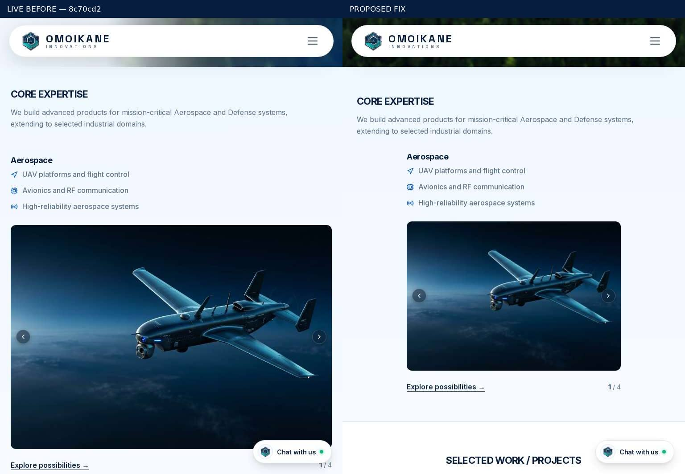
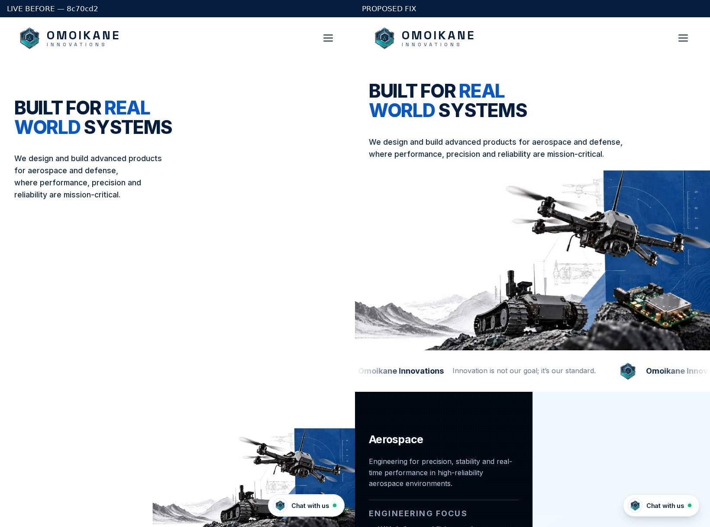
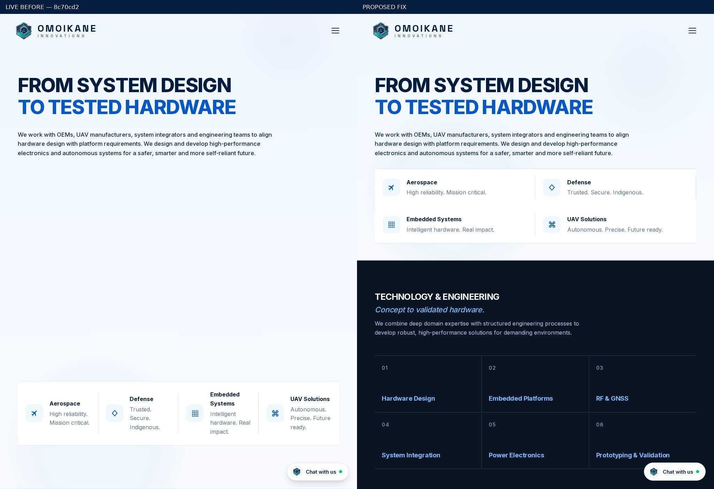
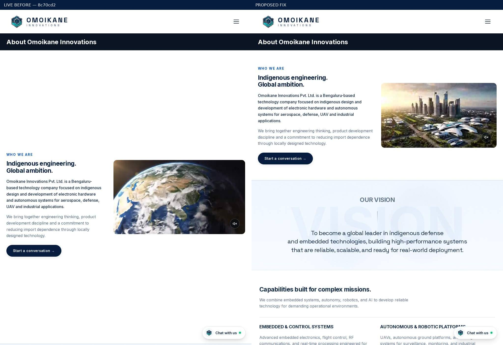

Latest screenshot requests: [TABLET_REQUESTED_DETAILS.md](TABLET_REQUESTED_DETAILS.md) covers the Mini Air-style photo, complete Mini/Air CTA, Mini landscape Leadership hero, Air Careers tabs and plain unnumbered FAQ controls.

Latest Mini Home correction: [MINI_HOME_HERO_REFINEMENT.md](MINI_HOME_HERO_REFINEMENT.md) restores the Air/Pro composition on Mini with bounded media and clear copy. This supersedes the preceding stacked Mini hero.

Latest document fixes: [CAREERS_CONTACT_TABLET_FIXES.md](CAREERS_CONTACT_TABLET_FIXES.md) covers sticky Air/Pro Careers navigation, the Mini Home hero, and Mini/Air/Pro Contact corrections. Earlier reports below describe preceding revisions.

Latest review: [TABLET_FINAL_LAYOUT_FIXES.md](TABLET_FINAL_LAYOUT_FIXES.md) addresses the newest annotated screenshots. Earlier reports below describe preceding revisions.

Latest owner-requested DOCX corrections are documented in [DOCX_VISUAL_FIXES.md](DOCX_VISUAL_FIXES.md). The report below describes the preceding revision.

# Responsive visual refinement: tablet correction, 27 November 2026

This report supersedes the acceptance claims in the earlier PR #66 report. PR #66 and PR #67 were already merged when this follow-up began. The live site still had visible sizing and spacing problems. The earlier report remains available in Git history.

## Version and scope

- Live alias inspected: https://omoikane-innovations-3h7t.vercel.app/
- Live/main SHA: `8c70cd2efc2b5233a740380aa076b80aa88d9fef`.
- Live immutable host: `omoikane-innovations-3h7t-41rbjf9ud-j-f4ac.vercel.app`, deployment `dpl_5M61zXdLDycemM5bPUc2QakVatmk`, READY.
- Proposed implementation SHA: `6b530e77f24101510eaf8634db8459170ba1dcc8`; implementation tree `99d92eeca905509b60dc07610c9f67faaf445b04` matches the local tested source tree.
- Review branch: `fix/live-responsive-proportions-20261127`.
- Owner instruction: Mini uses the approved phone reference; Air/Pro start from desktop, with mobile treatment where a component needs it. The owner's 12-page screenshot PDF was visually reviewed.
- Pages changed: Home, Technology, Leadership, Products, About and Contact. Existing photographs, copy, claims, profiles, legal pages and font tokens are retained.
- Review only. No merge/deployment was performed. Automatic Vercel deployment is disabled for this branch only. The production alias continues to serve the live SHA above.

## Review screenshots

[Open the offline comparison viewer](frontend/RESPONSIVE_QA/TABLET_REFINEMENT_20261127/index.html). It contains 14 labeled pairs at identical CSS viewports: live before on the left, proposed fix on the right. Comparisons are organized by route and device. [Measured geometry](frontend/RESPONSIVE_QA/TABLET_REFINEMENT_20261127/measurements.json) contains 27 live-before and 30 proposed-after route/device records. Full working captures remain under `frontend/RESPONSIVE_QA/live-followup/`, grouped by route/device, without adding another large screenshot archive to the PR.









## Measured defects and corrections

Dimensions below are rendered CSS pixels, rounded to two decimals. Borders are excluded from image dimensions where the measured node is the inner image. Ratios deliberately differ between product photos, sequence video, portraits and hero art.

| ID | Route / device | Before | After | Cause and correction |
|---|---|---|---|---|
| T01 | Home / Mini 768×1024 | Copy restricted to about 292px; desktop image behind phone headline | Copy uses the existing 540px phone container; mobile image below copy | A percentage width was applied inside an already narrow container; use the phone composition and source through 768px |
| T02 | Home / Mini | Carousel photo 720×503.25 | 480×335.50 | Unbounded phone carousel expanded to tablet width; cap the whole carousel at 480px, retaining all four sectors and controls |
| T03 | Home / Air 820×1180 | Aerospace photo 696×298; Core Expertise section 1701.55 high | Photo 238×148 inside a 240×150 frame; section 1190.94 high | Full-width tall card mixed with small horizontal cards; use a horizontal Aerospace row with bounded media at this intermediate width |
| T04 | Home / Air | Selected Work image 778×485.50 in a mobile stack | 364×226.75 beside copy | The 860px breakpoint sent Air to a large mobile accordion layout; desktop columns now start at 769px with `minmax(0,1fr)` tracks |
| T05 | Home / Mini | Selected Work image 726×453 | 478×298 inside a 480px frame | Cap phone-reference media without changing the accordion behavior |
| T06 | Technology / Air | Hero 1092 high; image squeezed into a 467px-wide bottom-right region | Hero 674.58 high; landscape artwork spans 820px | Viewport-height minimum combined with a restricted absolute image region caused a long empty area; tablet content and original landscape art flow without intersecting |
| T07 | Technology / Pro 1024×1366 | Hero 1278 high | Hero 800.38 high | Same cause; remove the viewport minimum and use the actual 1760:893 landscape ratio |
| T08 | Technology / phones | 4:5 frame positioned at 58%; large blank top and missing lower hardware | Square frame anchored to the bottom | Crop the asset's blank upper region while keeping the drone, tracked vehicle and board visible; original asset unchanged |
| T09 | Technology / desktop 1440×900 | Artwork restricted to 57% of the hero width | Lower-right frame uses 80% width / 70% height | Restore a visible artwork scale while retaining the headline position and lower-right anchor; see the desktop comparison |
| T10 | Leadership / Mini | Landscape blueprint in a 350px frame; two-column information band | Portrait blueprint in a 480×608.41 frame; stacked information band | Align image source, hero CSS and mobile reference breakpoint at 768px |
| T11 | Leadership / Air and Pro | Blueprint canvas 360.80 / 450.55 high | 319.30 / 396.83 high | Size the canvas from the actual 2034:773 landscape asset with 32px horizontal gutters and 16px vertical frame space |
| T12 | Leadership / tablets | Mini portraits 728px square; Air/Pro used 42vh, growing with tall screens | Mini max 480px square; Air/Pro 300–380px square | Bound portraits while retaining the vertical Mini gallery and horizontal desktop gallery; mobile dialog now matches the existing square gallery crop |
| T13 | Products / Mini, Air, Pro | Intro sections 1024 / 1180 / 1366 high | 591.81 / 687.52 / 708.98 high | `min-height:100svh` plus `space-between` pushed focus cards down an empty screen; use content height and 32px introduction-to-strip margin |
| T14 | Products / Mini | First product image 720×503.25 | 480×335.50 | Cap the original 289:202 photo ratio |
| T15 | Products / Air | First product image 772×539.59 in a long stacked row | 329.39×230.22 beside copy | Keep desktop image/text columns; images use the same original ratio and fit the available column |
| T16 | Products / Air and Pro | Row padding + container gap compounded to about 136 / 148.48 | 24px row padding + 24px gap = 48px | Remove compounded vertical spacing, plus redundant top margins before considerations/CTA; Mini keeps its existing 40px row gap |
| T17 | About / Pro | Intro 1196 high; engineering section 1366 high | Intro 529.89; engineering 634.25 | Viewport minimums reserved empty space; retain desktop copy/video columns with content-driven height |
| T18 | About / Air | Intro 884.95; engineering 1180; certifications 1354.41 high | 581.08 / 706.23 / 775.19 | Use the desktop intro split, remove engineering viewport height, use two certification columns with contained logos |
| T19 | About / Mini | Company video 405px high | 292.50px high, 520px wide | Keep the phone order and company video, bounded at its original 16:9 ratio |
| T20 | About / Air and Pro | Large viewport-driven certification/domain/FAQ spacing | 64px section edges and 32px introduction gaps | Scoped tablet spacing replaces only the affected component values; Vision divider becomes 48px with 24px below it |
| T21 | Contact / Air and Pro | Mobile context/form stack and large 420px minimum blueprint | Desktop context/form split; blueprint keeps 4:3 within its column | Use the desktop relationship and bounded contain media; form fields remain a single column inside their narrower form column |

No global font reset or new `!important` declarations were added. Existing mobile/desktop type families, weights and tokens remain in place. Home Air/Pro media receives more hero height (440px at Air, 532.47px at Pro) so the drone is proportionate instead of squeezed into a short strip. This is an intentional size increase, not a missed gap reduction.

## Device acceptance

| Device/configuration | CSS viewport(s) | Result / reference |
|---|---|---|
| iPad Mini | 768×1024 | Visually reviewed Home, Technology, Leadership, Products, About and Contact. Phone carousel, portrait hero sources and stacked galleries retained; media bounded |
| iPad Air | 820×1180 | All six pages visually reviewed. Desktop relationships for card/media rows, Technology rail, About intro, work accordion, Contact context/form; form fields adapt to one column |
| iPad Pro | 1024×1366 | All six pages visually reviewed. Desktop reference, with content-driven editorial heroes and bounded portraits/video |
| Tablet landscape | 1024×768, 1180×820, 1366×1024 | Home, Technology and Leadership hero screenshots captured and inspected; all six routes checked for layout and input bounds |
| Phone reference | 390×844 | All six pages captured; approved Home structure retained; Technology lower artwork and Leadership dialog ratio corrected |
| Desktop reference | 1440×900 | All six pages captured; desktop Technology artwork enlarged without moving its headline; other desktop reference structures retained |
| Additional matrix | 320×568, 360×740, 375×667, 393×786, 412×915 (Pixel and Galaxy DPRs), 414×896, 430×932, 1280×800, 1920×1080, 767/768/769×900, 1023/1024/1025×900 | Automated layout/input-bounds smoke checks on six routes; these are not claims of physical-device visual testing |

The 24 configurations reuse the declared device/DPR/touch matrix in `audit-responsive-visual.cjs`. Chrome headless emulation was used. WebKit/Safari and physical devices were not available and are not signed off.

## Files and selectors

All paths below are under `frontend/`.

| Files | Selectors/behavior changed |
|---|---|
| `src/components/shared/HeroBanner.jsx`, `.module.css` | Home picture source; `.homeHero`, `.homeBackdrop`, `.homeBackdropImage`, `.heroContent`; separate 681–768 Mini and 769–1100 Air/Pro treatment |
| `src/app/page.module.css`, `src/components/features/home/HomeClient.jsx` | `.bentoCardTall`, tablet image wrappers, `.expertiseSection`, `.whySection`, `.sectionHeader`, `.expertiseCarousel`; accurate bounded carousel `sizes` |
| `src/components/features/home/SelectedWork.module.css` | Mobile breakpoint 768; `.imageWrapper`, `.detailsContent`, `.introContainer`; Air/Pro columns |
| `src/components/features/home/TechnologyEngineering.module.css` | Matrix/mobile breakpoint 768; tablet `.cell` padding 24px × 20px |
| `src/components/features/expertise/ExpertiseHero.tsx`, `.module.css` | Mobile picture source through 768; `.hero`, `.content`, `.imageLayer`, `.heroImage`; actual asset ratio and bottom-anchored phone crop |
| `src/components/features/expertise/ExpertiseSection.tsx`, `.module.css` | Match JS/CSS breakpoint at 768; desktop scene anchor behavior at Air; `.leftInner`, `.copy`, `.nav`, `.scene` tablet bounds; desktop sticky split preserved |
| `src/components/features/expertise/AerospaceVideoSequence.module.css` | `.stage` max 480px on tablets, retaining 4:3 and the existing sequence |
| `src/components/features/leadership/LeadershipHero.jsx`, `.module.css` | Source and CSS breakpoint 768; `.canvas`, `.visualStage`, `.visualPlaceholder`, Mini information-band padding |
| `src/components/features/leadership/LeadershipGallery.module.css` | Mini `.gallery` max 480px; Air/Pro `.galleryImage` bounds; mobile dialog `.imageContainer` square |
| `src/components/features/work/WorkClient.module.css` | Tablet `.heroSection`, `.focusStripContainer`, `.focusStripTrack`, `.showcaseSection`, `.showcaseContainer`, `.productRow`, `.rowReversed`, `.collageCol`, `.collageCanvas`, `.editorialCol`, `.featuresGrid`, `.featureItem`, `.considerationsHeading`, `.productEnquiry` |
| `src/components/features/about/AboutHero.module.css` | Phone breakpoint 768; tablet `.hero`, `.copy`, `.split`; Mini `.film` max 520px |
| `src/app/about/page.module.css` | Tablet `.vision`, `.system`, `.credSection`, `.domains`, `.faqSection`; introduction/footer/divider gaps; two-column `.credGrid`, `.credCard`, `.credCardLogo`; original PR #63 decisions remain in source outside this explicit tablet correction |
| `src/app/contact/page.module.css`, `src/components/features/contact/ContactForm.module.css` | Tablet `.container`, `.enquiryVisualWrapper`, `.enquiryImage`, `.contactHeroWrapper`, `.enquiryGrid`, `.formWrapper`; input min-width/box sizing and single-column form through 1100px |
| `vercel.json` | Disable automatic deployment only for this review branch; existing branch restriction retained |

## Verification

- Production build, lint, TypeScript, site contracts, About film-only check and protected UI checks passed on the final source. No dependency changes; the existing installed dependency tree was used.
- 144 unique viewport/route layout checks passed; 48 Home/Products cases were rerun after the last spacing/media adjustment and passed. Checks cover status, page errors, horizontal overflow, one H1 and visible input bounds, including elements that a hidden-overflow wrapper might otherwise conceal.
- 30 visual capture cases across six pages × phone/Mini/Air/Pro/desktop, with full-page and scrolled section screenshots. Final Mini/Air/Pro Home and Products captures replace the intermediate iterations.
- 18 unique route/tablet axe scans: zero violations. Six Home/Products scans repeated after final adjustment: zero violations.
- 10 profile dialog cases (normal and reduced motion at 375/768/820/1024/1440): focus, Tab, Escape, focus return, close-control bounds and height passed.
- 10 Technology category URL cases (Aerospace/Defense at 390/768/820/1024/1440): correct active category and anchor passed after the breakpoint change.
- Six Technology sequence checks passed at Mini/Air/Pro in normal and reduced motion. Normal playback decoded and advanced; reduced motion retained a visible composition. [Playback evidence](frontend/RESPONSIVE_QA/TABLET_REFINEMENT_20261127/media/technology-mini-playing.jpg) and [runtime states](frontend/RESPONSIVE_QA/TABLET_REFINEMENT_20261127/video-checks.json). Pinned scenes were reviewed with scrolled viewport captures as well as full-page images.
- Four-sector Home carousel checks passed. Existing protected page/department contracts passed. Forms were filled only locally with invalid example addresses; production submissions/API calls were blocked.
- Mobile lab LCP was not rerun in this focused correction; no new media assets were added. A field/Core Web Vitals improvement is not claimed.

Reproduce from `frontend/` after building:

```sh
PLAYWRIGHT_MODULE=/path/to/playwright CHROME_PATH=/path/to/chromium \
  AXE_MODULE=/path/to/@axe-core/playwright node scripts/verify-tablet-refinement.cjs
PLAYWRIGHT_MODULE=/path/to/playwright CHROME_PATH=/path/to/chromium \
  node scripts/verify-tablet-matrix.cjs
```

[Interaction/axe results](frontend/RESPONSIVE_QA/TABLET_REFINEMENT_20261127/interactions-and-axe.json), [final spacing axe rerun](frontend/RESPONSIVE_QA/TABLET_REFINEMENT_20261127/final-spacing-axe.json), [144-case matrix](frontend/RESPONSIVE_QA/TABLET_REFINEMENT_20261127/matrix.json), [final 48-case rerun](frontend/RESPONSIVE_QA/TABLET_REFINEMENT_20261127/final-spacing-matrix.json).

## Remaining review and release status

The owner should review the 14 screenshot pairs before accepting the tablet art/crop and hybrid column decisions. This is now a concrete implementation, not a list of deferred image fixes. No further structural change is requested. Safari/physical-device verification and production release remain outstanding. Review PR only: do not merge or deploy without a new instruction.
