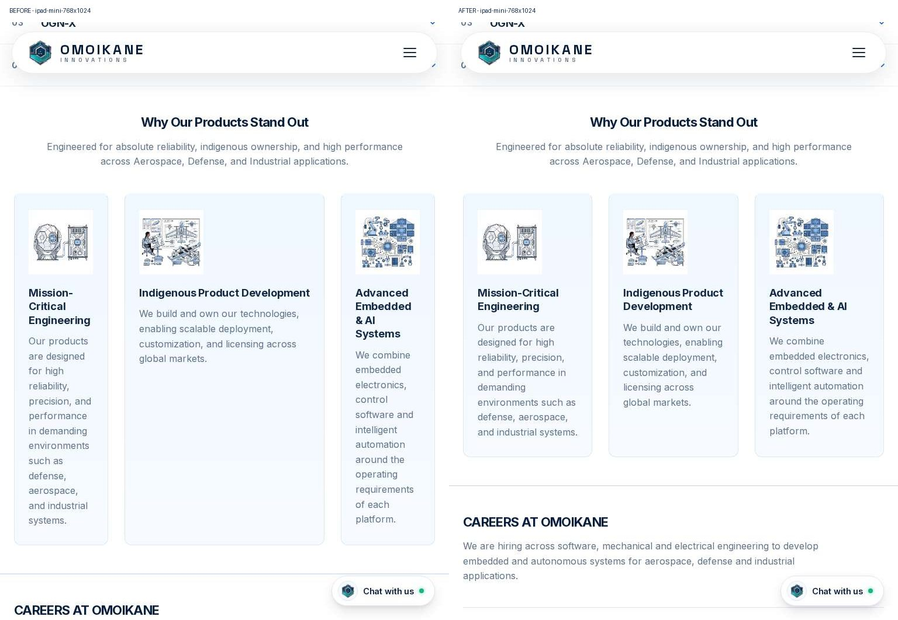
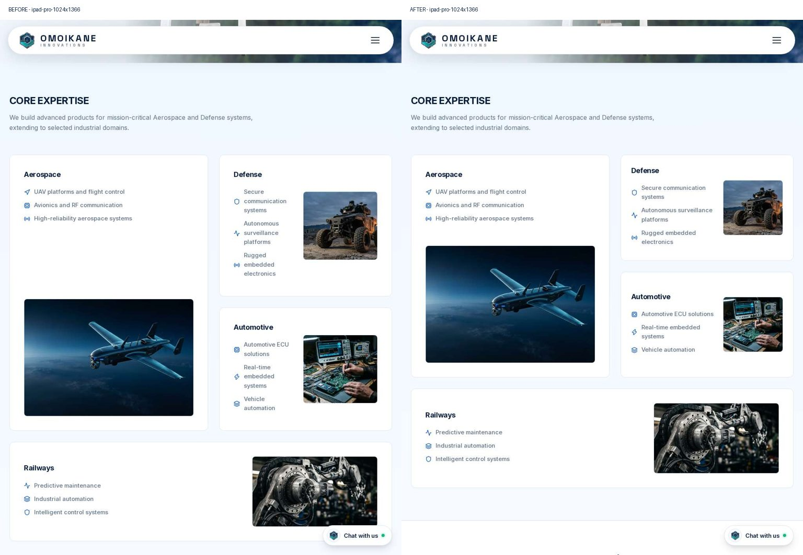
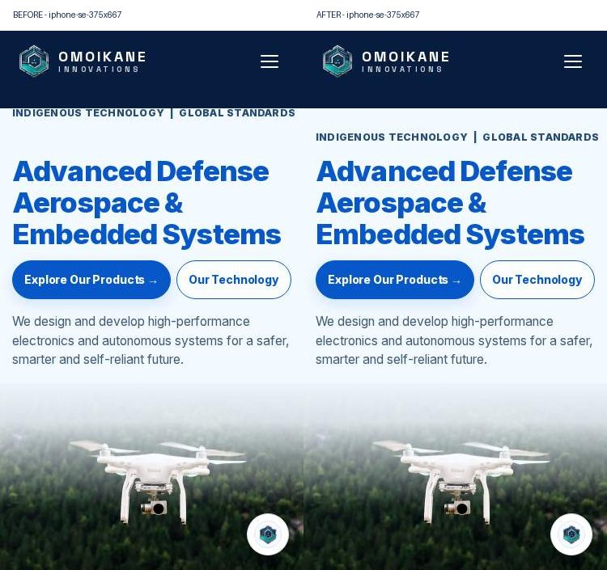

# Omoikane Innovations — Responsive Visual Refinement

Audit date: 27 November 2026. Review branch: `fix/responsive-visual-refinement-20261127`.

## Result and acceptance boundary

The implementation fixes confirmed card-width, tablet media, compounded spacing, short-phone clipping, Leadership dialog and mobile category-link defects. It preserves the approved page structures, font families, headline compositions, image assets, desktop Technology rail, Home carousel and bento, Careers explorer, Leadership gallery and PR #63 spacing.

The complete Chromium matrix comprises **24 device configurations × 12 public routes = 288 before and 288 after cases**. Each case has a hero screenshot, full-page screenshot, section viewport screenshots and computed geometry. Results: HTTP 200 throughout; no document overflow or JavaScript page errors. The final changed routes were recaptured after their last changes. Separate checks cover 120 route/viewport combinations, 48 axe scans, 10 profile dialog cases, 10 category links, 13 first-visit/navigation/form layouts, all career-role Apply URLs and decoded company video. Detailed outcomes and limitations follow.

**Review is still required for the existing Technology hero artwork/text intersection, possible broader type scaling and intentionally abbreviated mobile copy. WebKit and physical-device acceptance remain outstanding.** These are identified below; a passing overflow check is not treated as visual approval.

## Version and baseline provenance

| Item | Verified value |
|---|---|
| Repository | `jayanthreddy2805/Omoikane-Innovations` |
| GitHub main, checked at start | `1a8537ad53c0b3d58accfd09033dc62218dc353e` |
| Live alias | https://omoikane-innovations-3h7t.vercel.app/ |
| Live deployment ID | `dpl_FV736gJCrUVnnHvKqbmNtdFUX4Hw` |
| Immutable deployment host | `omoikane-innovations-3h7t-ehcnchv0b-j-f4ac.vercel.app` |
| Live Git SHA, checked again before handoff | `1a8537ad53c0b3d58accfd09033dc62218dc353e` — READY, production |
| Tested implementation / working branch SHA | `c3cd67d3f772644d62bcf0ebeb5c1bc6b35d5324` |
| Published implementation SHA | `44378dcf37e4b0308f09b128d3eb5a25bfb5c0f9` |
| Source tree equality | `bd5313671d81398d1eaac945f885abf502c72acc` — identical for the tested local commit and published implementation |
| Evidence commit | Subsequent report/evidence-only commit on this branch; use PR HEAD for the complete review package |

Live Vercel captures at **1440×900 and 390×844 on all 12 routes** were completed before editing CSS. Home/About were additionally captured live at 768×1024, 820×1180 and 1024×1366 to corroborate the tablet defects. The full before matrix used a local production build of the exact live SHA. The after matrix used production builds of the changed source, with complete recaptures of Home, Leadership and Technology after their final changes. The final accepted build's application source was compared against the working tree.

Available approved references reviewed: current production desktop/mobile layouts, committed `TASK_7_QA/screenshots/home-core-expertise-390.jpg`, `about-video-only-390.jpg`, `technology-defense-1440.jpg`, the protected UI contract scripts and PR #63's `f1d46bb` spacing changes. No new owner approval is inferred for a different headline layout or photographic focal point.

Changes after the previous responsive QA: `1a8537ad` renamed/refactored the shared HeroBanner and modified typography overrides, layout, Expertise hero/section and Leadership gallery. This audit uses fresh captures rather than inheriting the earlier acceptance result. The following PR #63 values remain intact: Vision `7rem 5% 6rem`, Mission Domains `7rem 5% 6rem`, Domains header `32px` top/`48px` bottom spacing at desktop, Careers explorer `5rem 5%`, How We Work bottom spacing, and gallery header/mobile top spacing.

## Evidence navigation

- [Offline before/after screenshot index](frontend/RESPONSIVE_QA/index.html): select a route, device and section. This is a local evidence viewer; it makes no service calls.
- [Route-by-route, device-by-device measurements and screenshot links](frontend/RESPONSIVE_QA/FINDINGS_BY_ROUTE_AND_DEVICE.md).
- Complete captures are packaged by phase and route in [capture-archives](frontend/RESPONSIVE_QA/capture-archives/manifest.json), with SHA-256 checksums. Large archives use upload-sized parts, automatically reassembled by the helper. After cloning, run `python frontend/scripts/unpack-responsive-evidence.py` before using section selections in the offline index. Key review captures remain directly browsable in GitHub; restore the archives for the complete matrix and offline viewer.
- [Before computed geometry](frontend/RESPONSIVE_QA/before/measurements.json) and [after computed geometry](frontend/RESPONSIVE_QA/after/measurements.json).
- [Live desktop/mobile baselines](frontend/RESPONSIVE_QA/capture-archives/live-baseline.zip) and [live tablet corroboration](frontend/RESPONSIVE_QA/capture-archives/live-tablets.zip).
- Screenshot layout: `frontend/RESPONSIVE_QA/{before,after}/<route>/<device>-<width>x<height>/`. Each contains `hero.jpg`, `full.jpg`, and numbered section viewport captures. `captures` in the JSON records the label, scroll offset and progress for each section capture.

Fonts were awaited before captures. Pages were scrolled in 75%-viewport steps to activate lazy media/animations, then sections were captured after settling. Tall/sticky sections have additional midpoint and late-progress captures. Full-page images flatten pinned states and are **not** used alone to diagnose cinematic whitespace. Video frames and live atmospheric animations can differ between captures without a layout change. JPEG previews use CSS-pixel dimensions; DPR is separately emulated and recorded.

## Confirmed defects and exact changes

All values below are rendered CSS pixels unless explicitly described as a rule value. None of these fixes requires a new page structure or a substantial crop choice.

| ID | Route / viewport | Existing computed problem and cause | Applied dimensions / behavior | Structural approval |
|---|---|---|---|---|
| RV-01 | Home, 320×568 / 360×740 / 375×667 | Why cards stay **341.61px** wide even when their available width is 272 / 312 / 327px. A forced nowrap title creates a min-content grid width; outer overflow hiding masks the defect. | `minmax(0,1fr)`, `min-width:0`, natural title wrapping. Card widths become **272 / 312 / 327px**; content grows vertically. 390×844 remains 342px. | No |
| RV-02 | Home, 768×1024 and 768×900 | Three Why columns are **161.19 / 341.61 / 161.20px**; narrow side text areas are **111.19px**. All cards stretch to **603.89px** high. | Three equal **221.33px** cards, **171.33px** text widths; cards become **452.53px** high. Grid retains three columns and the 28px gap. | No |
| RV-03 | Home bento, 960–1279px; measured at 1024×1366 | Horizontal-card copy has **152.92px** width beside fixed 190×175px image wrappers and 36px card padding. Defense/Automotive links are **361.89 / 314.80px** high. | Same bento, fluid image wrapper **153.59×141.45px**, 25.6px padding and 20px internal gap at 1024px. Copy becomes **214.14px** wide. Natural shared rows become **270.44px** each, with no fixed content height. Desktop ≥1280px retains original card/media dimensions. | No |
| RV-04 | Home transitions, all matrix sizes | A trailing 48px bento margin or 32px carousel margin compounds the section's own bottom padding. At 1440×900 the visible grid-to-section-edge distance is **164.18px**; at 1024×1366 it is **130.91px**. | Remove only those trailing margins. Distances become **116.18px** and **82.91px**. Phone section height falls exactly 32px while its 48px per-edge padding and media sizes remain unchanged. At 390px the next section heading moves from y=1682.75 to 1650.75. | No |
| RV-05 | About certifications, 961–1279px; measured at 1024×1366 | Logo widths of 170–230px plus desktop padding/gap leave **162.38px** copy width in three cards and **102.38px** in MSME. Equivalent text blocks range from 141.17 to 192.36px high. | Keep two horizontal cards per row. Use **24px** card padding/gap and a **140px** logo column. All copy areas become **228.38px**, with **115.58px** text blocks. Logos remain contained and proportional; desktop ≥1280 and phone layouts retain their original sizing. | No |
| RV-06 | Leadership profile dialog, phones; 390×844 evidence | Absolute `width:100%` starts inside a padded overlay. Modal content extends to **x=410px** on a 390px screen; the close button is partly outside and only **38.38px** high. | Mobile content width is `calc(100% - 40px)`, left=20px. At 390px content is **350px** wide, with a **44px minimum** close control fully within the viewport. Preserve the existing 4:3 modal media frame and square gallery portraits. | No |
| RV-07 | Leadership dialog, reduced motion at 375 / 768 / 820 / 1024 / 1440px | Zero-duration GSAP opening can skip `onStart`. The shared reduced-motion duration also creates inherited visibility transitions on descendants, so focus arrives while the close button is still hidden. | Visibility follows open state; reduced-motion open/close has an immediate state path; close refs remain mounted. Suppress transitions **only inside this gallery/dialog under reduced motion**. Opening focus, Tab containment, Escape and return focus pass at all five widths in both motion settings. Normal animations remain. | No |
| RV-08 | About FAQ, tablet/desktop | FAQ ordinal color `#8FA6C0` on white is **2.5:1** in axe. | Use the existing muted token `#62748A`, approximately **4.79:1** on white. Text size, weight, layout and hover blue remain unchanged. | No; existing palette token |
| RV-09 | Home hero, 320×568 / 375×667 | Short-height content removes its container transform but leaves eyebrow `translateY(-30px)`. Hero top=**96px**, eyebrow top=**92px**: **4px** is clipped. | Remove only the short-height eyebrow transform. Eyebrow top=**122px**, clipping=**0px**. 390×844 remains at y=142px. No font or headline-wrap change. | No |
| RV-10 | `/expertise#defense`, 390 / 768 / 820px | Mobile/tablet layout removes the desktop article anchors; direct Defense links open **Aerospace** with no Defense anchor. Desktop 1024/1440 already works. | Follow the category fragment only in the existing ≤1000px sequence, expose the active category's section anchor, and scroll that section into view. Both category links pass at 390 / 768 / 820 / 1024 / 1440px. Desktop observers/sticky split are unchanged. | No |

### Before / after screenshot examples

[768px Why cards — source before](frontend/RESPONSIVE_QA/before/home/ipad-mini-768x1024/section-03-0.jpg) · [source after](frontend/RESPONSIVE_QA/after/home/ipad-mini-768x1024/section-03-0.jpg)



[1024px bento — source before](frontend/RESPONSIVE_QA/before/home/ipad-pro-1024x1366/section-01-0.jpg) · [source after](frontend/RESPONSIVE_QA/after/home/ipad-pro-1024x1366/section-01-0.jpg)





Dialog evidence: [baseline reduced motion](frontend/RESPONSIVE_QA/dialog-before/reduce.jpg), [refined 375px reduced motion](frontend/RESPONSIVE_QA/verification/dialog-375-reduce.jpg), [refined 1440px normal motion](frontend/RESPONSIVE_QA/verification/dialog-1440-no-preference.jpg). The focused-control and viewport assertions are in [dialogs.json](frontend/RESPONSIVE_QA/verification/dialogs.json).

## Typography, spacing and media audit

No global typography override, family, font-weight, font-color system, heading composition or new `!important` was introduced. Existing main-content overrides and responsive display exceptions were read before editing. The only color correction reuses an existing palette token for FAQ numbers. The nowrap removal changes the number of lines where the card was overflowing, not its type scale.

| Measurement | Before → after |
|---|---|
| Home Why images | 110×110px contained diagrams → unchanged |
| Home Why heading, 768px | Existing 18px type, 23.39px line-height → unchanged; wrapping becomes natural |
| Home bento image pixels inside border, 1024px | 188×173 → **151.59×139.45**, cover at 50% 50%; original wrapper ratio 190:175 retained |
| About ISO mark, 1024px | 135×135 contained → unchanged |
| About MSME mark, 1024px | 230×79.06 → **140×48.13**, contained, same source and proportions |
| About Startup India mark, 1024px | 170×46.45 → **140×38.27**, contained |
| About Startup Karnataka mark, 1024px | 170×73.84 → **140×60.81**, contained |
| Leadership portraits | Existing square gallery and existing 4:3 mobile dialog → unchanged proportions and assets |
| Careers hero / role images | Existing 16:9 mobile and existing desktop framing → unchanged |
| Inputs | Visible text inputs/textarea use **16px** on mobile; heights ≥44px (e.g. Contact 54px input / 46px phone / 140px textarea). Existing custom select is a div combobox and retains its approved type. |

Image assets, responsive sources, image `sizes`, video sources and download resolutions are unchanged. The bento media scales down at tablets; certification marks keep `contain`. No image was enlarged, stretched or replaced. Current Home/Products image crops, Leadership portrait framing, About video-only hero, cinematic section heights and the PR #63 spacing changes were retained. At 390px the existing 24px Home section gutter is preserved rather than blindly enforcing a different global gutter.

## Device-by-device findings

All devices below ran all 12 routes, with full-page and section captures in both phases. Routes: `/`, `/about`, `/expertise`, `/work`, `/leadership`, `/careers/software`, `/careers/mechanical`, `/careers/electronics`, `/contact`, `/apply`, `/privacy`, `/terms`. Galaxy S20 Ultra and Pixel 7 are separate contexts despite the same CSS viewport.

| Device | CSS viewport | DPR / touch | Visual findings and outcome |
|---|---|---|---|
| iphone-se | 375×667 | 2 / yes | RV-01/04/06/07/09 fixed; short-height hero fully visible; other layouts retained. |
| iphone-xr | 414×896 | 2 / yes | RV-04/06/07 fixed; carousel, product accordion, portraits and forms retain framing. |
| iphone-12-pro | 390×844 | 3 / yes | Approved mobile baseline preserved; RV-04/06/07 and Defense link fixed. |
| iphone-14-pro-max | 430×932 | 3 / yes | RV-04/06/07 fixed; headline composition and media framing retained. |
| pixel-3-xl | 393×786 | 2.75 / yes | RV-04/06/07 fixed; no short-height eyebrow override applied. |
| pixel-7 | 412×915 | 2.625 / yes | RV-04/06/07 fixed; independent 2.625 DPR context. |
| galaxy-s8-plus | 360×740 | 4 / yes | RV-01/04/06/07 fixed; cards use the 312px available width. |
| galaxy-s20-ultra | 412×915 | 3.5 / yes | RV-04/06/07 fixed; independent 3.5 DPR context. |
| ipad-mini | 768×1024 | 2 / yes | RV-02/04/06/07/10 fixed; approved carousel remains at 768px; three Why columns remain. |
| ipad-air | 820×1180 | 2 / yes | Mobile menu / stacked Careers hero / horizontal role strip retained. RV-04/07/10 fixed. Technology hero overlap flagged D-01. |
| ipad-pro | 1024×1366 | 2 / yes | RV-03/04/05/07/08 fixed. Tablet bento and two-column certificate cards retained. D-01 remains for owner crop decision. |
| narrow | 320×568 | 2 / yes | RV-01/04/06/07/09 fixed. 272px Why cards grow naturally. Small approved eyebrow type retained; broader sizing is D-02. |
| ipad-mini-landscape | 1024×768 | 2 / yes | RV-03/04/05/07/08 fixed; navigation fits; desktop Technology split retained. |
| ipad-air-landscape | 1180×820 | 2 / yes | RV-03/04/05/07/08 fixed; desktop bento arrangement and sticky rail retained. |
| ipad-pro-landscape | 1366×1024 | 2 / yes | RV-04/07/08 fixed; original desktop card/media dimensions retained. |
| desktop-1280 | 1280×800 | 1 / no | RV-04/07/08 fixed; original desktop bento card/media sizes retained. |
| desktop-1440 | 1440×900 | 1 / no | Approved desktop reference preserved; only compounded Home spacing, FAQ contrast and reduced-motion dialog handling change. |
| desktop-1920 | 1920×1080 | 1 / no | Same desktop arrangement/max-width behavior retained; RV-04/07/08 fixed. |
| break-767 | 767×900 | 1 / no | Mobile composition retained; no new breakpoint switch. RV-04/06/07/10 fixed. |
| break-768 | 768×900 | 1 / no | RV-02/04/06/07/10 fixed; carousel persists; Why columns equal. |
| break-769 | 769×900 | 1 / no | Existing single-column desktop bento begins; no breakpoint change. RV-04/07/10 fixed. |
| break-1023 | 1023×900 | 1 / no | RV-03/04/05/07/08 fixed; horizontal Careers role navigation remains. |
| break-1024 | 1024×900 | 1 / no | RV-03/04/05/07/08 fixed; existing split Careers hero/sidebar remains usable. |
| break-1025 | 1025×900 | 1 / no | RV-03/04/05/07/08 fixed; original How We Work breakpoint retained. |

Tablet-specific review covered navigation fitting, 768/820/1024 separate acceptance cases, portrait/landscape galleries, sticky video/text rails, Careers role navigation transitions, image/text splits, labels and form widths. Existing breakpoints were retained; only component sizing within confirmed failing ranges changed.

## Exact affected source

| File | Selectors / behavior |
|---|---|
| `frontend/src/app/page.module.css` | `.bentoGrid`, `.bentoTextCol`, tablet `.bentoRightStack` / its direct children, tablet `.bentoCardHorizontal` / `.bentoImgWrapper`, `.expertiseCarousel`, `.whyCardTitleSingleLine`, `.whyGrid`, `.whyCard` |
| `frontend/src/app/about/page.module.css` | `.credGrid`, `.credCardContent`, tablet `.credCard`, `.credCardLogo`, `.credCardLogo img`, `.faqNumber` |
| `frontend/src/components/shared/HeroBanner.module.css` | Short-height `#main-content .homeHero .heroContent .eyebrow` only |
| `frontend/src/components/features/leadership/LeadershipGallery.module.css` | `.closeButton`, mobile `.content`, reduced-motion `.sectionContent` / descendants and `.scrollWrapper` / descendants |
| `frontend/src/components/features/leadership/LeadershipGallery.js` | State-derived dialog visibility, stable close refs, reduced-motion open/close/focus path; normal animation timeline retained |
| `frontend/src/components/features/expertise/ExpertiseSection.tsx` | Mobile category-fragment effect, hashchange cleanup, conditional active section ID; desktop rail untouched |
| `frontend/scripts/audit-responsive-visual.cjs` | Reproducible 24-device screenshot/geometry collection; no POST/API activity |
| `frontend/scripts/verify-responsive-visual.cjs` | Geometry/form, axe, dialog and category-link checks; external QA dependencies only |
| `frontend/scripts/unpack-responsive-evidence.py` | Verify archive checksums and restore section captures in their original route/device folders |
| `frontend/vercel.json` | **Only this review branch** has automatic Git deployment disabled; main/other branches are unspecified and retain their settings |

Vercel branch guard follows [git.deploymentEnabled documentation](https://vercel.com/docs/project-configuration/git-configuration). No deployment, domain, backend, database or production dashboard setting was changed. No backend, legal content, leadership copy, client images or product claims were edited.

## Regression outcomes

| Check | Result / evidence |
|---|---|
| `npm ci` | Passed; application lockfile unchanged. [Log](frontend/RESPONSIVE_QA/verification/npm-ci-responsive.txt) |
| ESLint | Passed. [Log](frontend/RESPONSIVE_QA/verification/responsive-lint.txt) |
| TypeScript `npx tsc --noEmit` | Passed. [Log](frontend/RESPONSIVE_QA/verification/responsive-typescript.txt) |
| Existing `npm test` | Passed with `SITE_AUDIT_EXCLUDE_CHATBOT=1`, respecting the explicit exclusion. [Log](frontend/RESPONSIVE_QA/verification/responsive-tests.txt) |
| Protected UI source contracts | Passed. [Log](frontend/RESPONSIVE_QA/verification/responsive-protected.txt) |
| Production build | Passed; final accepted source matched the working tree. [Log](frontend/RESPONSIVE_QA/verification/responsive-build-accepted.txt) |
| Complete visual matrix | 288 before + 288 after, zero HTML errors, document overflow or browser page errors. Saved section captures inspect animated/sticky states. |
| Geometry/forms + axe | 120 route/viewport checks; 48 axe scans across all 12 routes at 375/768/1024/1440px; **zero axe violations** in main/header/footer. [JSON](frontend/RESPONSIVE_QA/verification/layout-accessibility.json) |
| Leadership dialog | 10 cases: reduced/normal at 375/768/820/1024/1440px. Visible dialog, contained ≥44px close control, focus, Tab, Escape and return focus pass. [JSON](frontend/RESPONSIVE_QA/verification/dialogs.json) |
| Existing protected interactions | Passed at 375/1440px: all Home sectors, Technology categories, Leadership, all departments, Apply prefills and reduced-motion About player. [Log](frontend/RESPONSIVE_QA/verification/responsive-interactions-final.txt) |
| First visit / navigation / forms | Passed at 13 sizes from 320 through 1920px, including tablet menus, Careers dropdown, cookie preferences and form header clearance. Short-phone cases rerun after RV-09. [Log](frontend/RESPONSIVE_QA/verification/responsive-mobile-polish-final.txt) |
| Role links, search and video | 60 checks across 390/820/1024/1440px: every role-specific Apply URL, search opening/closing, decoded company video. [JSON](frontend/RESPONSIVE_QA/flows.json) |
| Technology category URLs | Both sector fragments at 390/768/820/1024/1440px. [Before](frontend/RESPONSIVE_QA/technology-links-before.json) · [After](frontend/RESPONSIVE_QA/technology-links-after.json) |
| Production forms | No real data submitted; form state/labels/keyboard interactions checked locally, API requests blocked during visual collection. |
| WebKit | Browser download succeeded, but required native libraries were unavailable; installing host dependencies failed because privileged package installation was unavailable. **Not tested in WebKit/Safari.** |
| Physical devices | **Not tested.** Named devices are Chrome-equivalent CSS/touch/DPR emulation, not physical hardware. |

The initial dialog and FAQ failures were fixed and retested; no failing product assertion was waived. Off-screen honeypots and the existing div combobox were excluded from the visible-native-input size assertion rather than changing their application behavior.

### Mobile LCP

Local production builds; three alternating cold Lighthouse runs per phase at 390×844, mobile form factor, 4× CPU slowdown, 150ms requested latency and 1638Kbps requested download throughput. These are repeatable lab comparisons, not field Core Web Vitals or physical-device claims. The final Home check was repeated after RV-09. The later Technology change is route-local; Home/About code, assets and initial rendering are unchanged.

| Route | Before LCP runs (ms) | After LCP runs (ms) | Median before → after | CLS |
|---|---|---|---|---|
| home | 3419, 3406, 3393 | 2725, 3384, 3411 | 3406 → 3384ms | 0 in all runs |
| about | 1062, 1056, 1061 | 1061, 1060, 1059 | 1061 → 1060ms | 0 in all runs |

No measured LCP regression in these samples; Home remains around 3.4s in the simulated profile. No quality reduction or asset replacement was used to obtain the result. [Raw Lighthouse evidence and summary](frontend/RESPONSIVE_QA/lcp/summary.json).

## Remaining owner decisions and limits

| ID | Evidence / decision | Why not changed automatically |
|---|---|---|
| D-01 | Technology hero artwork intersects dark headline/copy at 820px, 1024px and several landscape/desktop ratios. See [820px](frontend/RESPONSIVE_QA/after/expertise/ipad-air-820x1180/hero.jpg) and [1024px](frontend/RESPONSIVE_QA/after/expertise/ipad-pro-1024x1366/hero.jpg). Choose whether to adjust the focal point, white image-side gradient or text composition. | This needs a substantial crop/composition decision against the approved hero. The sticky split, dark rail and mobile sequence are preserved. |
| D-02 | Current approved global overrides produce several section titles at 22px mobile / 25px desktop and some hero sizes below the assignment's initial targets; the 320px Home eyebrow is 9px. Increasing the scale consistently would affect approved wraps and card composition. | No blanket font rewrite. All existing families, weights and approved hero compositions are retained. |
| D-03 | Existing five-line mobile product excerpts and three-line Mission Domains details deliberately use ellipses. Enlarging the 110px Home diagram tiles is another possible visual choice. | The existing 4:3 mobile profile dialog also frames portraits more tightly than the square gallery. Expanding copy, changing that portrait focal point/ratio or substantially resizing the diagrams would alter an established composition; retained and explicitly disclosed rather than treated as accidental clipping. |
| D-04 | Safari/WebKit and physical iPhone/iPad testing remain open. | Host libraries and physical devices were unavailable. Chromium emulation does not establish Safari acceptance. |

No structural redesign is proposed in this PR. The remaining decisions are review items, not hidden changes or claims of complete visual sign-off.

## Reproduction

Build the checked-out frontend with `npm ci && npm run build`. Use an external QA installation of Playwright, axe and Lighthouse; no QA libraries were added to application dependencies. Set `PLAYWRIGHT_MODULE` to that Playwright installation and `CHROME_PATH` to its Chromium executable.

```sh
START_SERVER=1 OUT=RESPONSIVE_QA/recheck node scripts/audit-responsive-visual.cjs
AXE_MODULE=/absolute/path/to/@axe-core/playwright node scripts/verify-responsive-visual.cjs
DIALOG_ONLY=1 AXE_MODULE=/absolute/path/to/@axe-core/playwright node scripts/verify-responsive-visual.cjs
LINKS_ONLY=1 AXE_MODULE=/absolute/path/to/@axe-core/playwright node scripts/verify-responsive-visual.cjs
```

The audit waits for the production server in its own process, blocks API requests/non-GET actions, records DPR/touch flags, scrolls sections and retains CSS-pixel screenshots. To reproduce the before phase, use an isolated checkout of the live SHA and the same audit script. Change `OUT` to preserve the original evidence. To restore the section files after cloning, run `python frontend/scripts/unpack-responsive-evidence.py`. Then open `frontend/RESPONSIVE_QA/index.html` with the adjacent evidence directories available.
